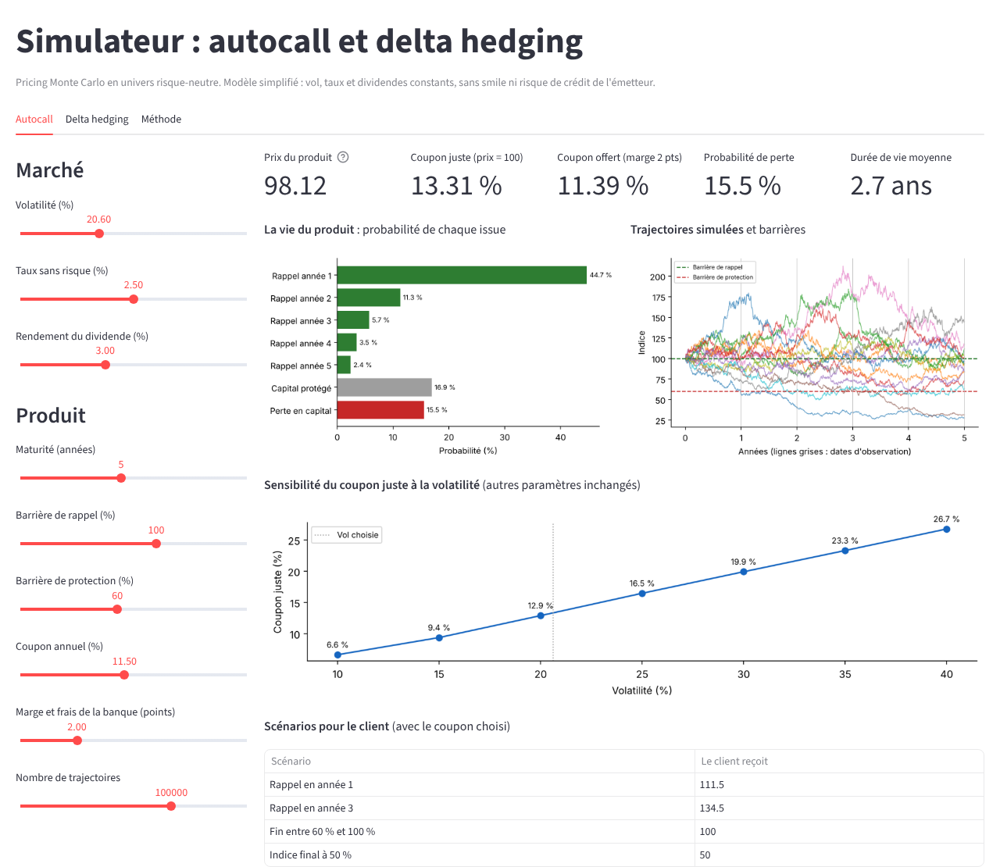

# Pricer d'autocall et étude de delta hedging
**Simulateur en ligne : [autocall-pricer.streamlit.app](https://autocall-pricer.streamlit.app)**

Projet personnel en Python : pricing Monte Carlo d'un autocall sur indice, calcul du coupon
qu'une banque peut offrir, et simulation de la couverture en delta d'une option vendue.



## Contenu

| Fichier | Rôle |
| --- | --- |
| `autocall.py` | Pricer d'autocall : simulation risque-neutre, payoff, prix, coupon juste, sensibilités |
| `delta_hedge.py` | Black-Scholes, delta, stratégie de couverture et étude Monte Carlo sur 1 000 trajectoires |
| `app.py` | Simulateur interactif Streamlit qui reprend les deux études |

## Le produit

Autocall 5 ans sur indice, observé une fois par an :

- si l'indice est au-dessus de la barrière de rappel (100 %) à une date d'observation, le produit
  s'arrête et le client reçoit 100 + 100 × coupon × nombre d'années écoulées ;
- s'il n'est jamais rappelé, à l'échéance seulement : le client récupère 100 si l'indice est
  au-dessus de la barrière de protection (60 %), sinon 100 × performance finale.

## Méthode

1. **Simulation risque-neutre** de l'indice, avec une dérive égale au taux moins le dividende.
2. **Payoff** appliqué à chaque trajectoire : montant reçu par le client et année du paiement.
3. **Prix** : moyenne des flux actualisés sur N trajectoires, avec l'erreur Monte Carlo.
4. **Coupon juste** : avec des trajectoires fixées, les dates de rappel ne dépendent pas du coupon,
   donc le prix est une droite en fonction du coupon. Deux prix suffisent pour trouver le coupon
   qui donne un prix de 100.

Chaque brique est validée : parité call-put, moyenne risque-neutre, payoffs sur des trajectoires
construites à la main, delta vérifié par différence finie.

## Principaux résultats

**Coupon juste aux conditions de marché d'octobre 2026** (taux 2,5 %, dividende 3 %, vol 20,6 %) :
environ 13,5 % par an pour un prix de 100, et environ 11,5 % avec 2 points de marge et de frais.

**Sensibilités du coupon juste** (base : taux 3 %, dividende 3 %, vol 20 %) :

| Paramètre | Variation | Coupon juste |
| --- | --- | --- |
| Volatilité | 15 % → 30 % | 9,6 % → 20,3 % |
| Dividendes | 1 % → 5 % | 10,2 % → 17,9 % |
| Taux | 1 % → 5 % | 12,7 % → 14,3 % |

Les dividendes jouent beaucoup plus que les taux : ils n'agissent que sur le forward, toujours
contre le client, alors que les taux ont deux effets opposés (obligation moins chère, mais forward
plus haut).

**Delta hedging** : un call vendu à 20 % de vol implicite et couvert chaque jour donne un P&L
moyen d'environ +4, 0 et −4 pour une vol réalisée de 10 %, 20 % et 30 %, soit exactement l'écart
de prime Black-Scholes. La couverture élimine le risque de direction mais laisse un pari sur la
volatilité.

## Limites

- Volatilité constante : pas de smile ni de skew, alors que le put implicite à 60 % y est sensible.
- Taux et dividendes constants, pas de spread de crédit de l'émetteur.
- Précision d'environ ±0,5 point de coupon avec 2 000 trajectoires dans `autocall.py`.

## Lancer le projet

```
pip install -r requirements.txt
python autocall.py
python delta_hedge.py
streamlit run app.py
```

Le simulateur utilise une version vectorisée (numpy) du même moteur, qui ne simule que les dates
d'observation annuelles : les résultats se mettent à jour instantanément.
